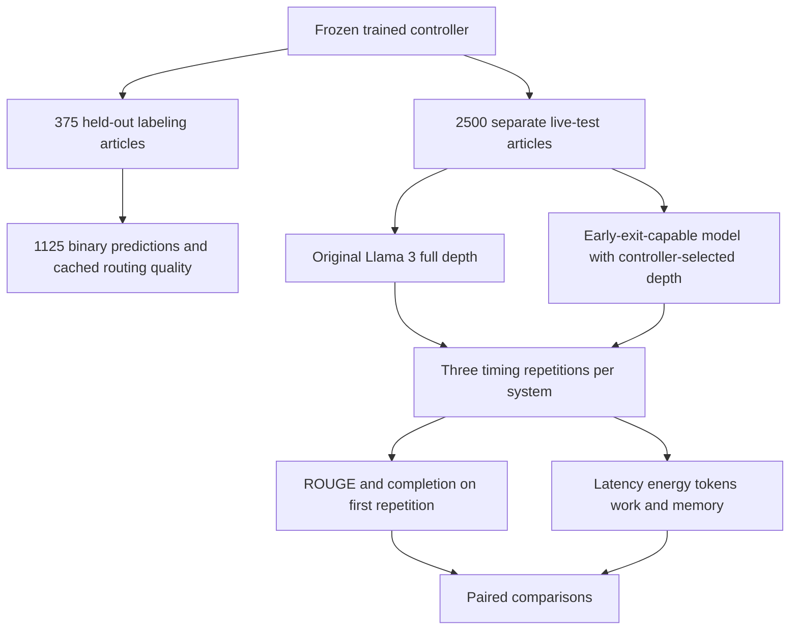

# Evaluation and Results: 2500-Article Run

## Evaluation aims

The evaluation asks whether the trained controller predicts acceptable article-depth outputs and whether its depth choices improve summarization efficiency while preserving quality. The two evaluation sets serve different purposes:

| Evaluation | Data                                                           | Main measurements |
|---|----------------------------------------------------------------|---|
| Controller evaluation | 375 held-out articles, 1125 article-depth labels               | Accuracy, precision, recall, F1, confusion matrix, cached routing quality |
| Live system test | 2500 separate test articles, two systems, three timing repeats | ROUGE, completion, latency, output tokens, estimated work, GPU memory and energy |

## 1. Held-out controller evaluation

The frozen controller was evaluated on 375 articles excluded from training and validation. Each has three candidate depths, giving 1125 binary quality-label predictions. References define the offline labels.

| Metric | Result |
|---|---:|
| Classification threshold | 0.5 |
| Accuracy | 75.73% |
| Precision | 78.01% |
| Recall | 75.25% |
| F1 | 76.60% |
| True positives | 149 |
| True negatives | 135 |
| False positives | 42 |
| False negatives | 49 |

| Cached routing metric |         Result |
|---|---------------:|
| Depth 24 / 28 / 32 selections | 184 / 129 / 62 |
| Mean depth |        26.6987 |
| Controller ROUGE-L |         0.2427 |
| Full-depth ROUGE-L |         0.2290 |
| Controller ROUGE-L difference |  0.0137 points |
| Controller completion rate |         94.33% |

## 2. Live comparison protocol

The live comparison used 2500 separate CNN/DailyMail test articles. Two systems were each run for three timing repetitions: **2500 × 2 × 3 = 15,000 measured generations**, excluding warmups.

| System | Model and inference |
|---|---|
| Original Llama 3 | `meta-llama/Meta-Llama-3-8B`, all 32 layers |
| Controller-routed early exit | Early-exit-capable Llama 3 8B checkpoint; controller selects 24, 28, or 32 layers |

Both systems received identical three-shot prompts and input token IDs, greedy decoding, and the same 192-token output cap. Quality uses the first repetition for 2500 unique articles; timing and energy aggregate all three repetitions. Latency includes input transfer, generation, and CPU routing, with GPU synchronization. It excludes loading, tokenization, warmups, ROUGE scoring, and disk writes. Checkpoint order reverses across repetitions, and the order in which the baseline and controller-routed system run alternates by article.

## 3. Live test results

ROUGE values are F1 scores on a 0–1 scale.

| Metric                  | Original Llama 3 baseline | Controller-routed early exit |
|-------------------------|--------------------------:|-----------------------------:|
| ROUGE-1                 |                    0.3861 |                       0.3917 |
| ROUGE-2                 |                    0.1556 |                       0.1610 |
| ROUGE-L                 |                    0.2577 |                       0.2638 |
| Completion rate         |                     96.2% |                        94.8% |
| Mean latency/article    |                   1.359 s |                      0.841 s |
| Output tokens/second    |                     84.86 |                        68.57 |
| Mean depth              |                        32 |                       27.264 |
| Mean reported GPU power |                  448.26 W |                     408.14 W |
| Quality-rule pass rate  |                     73.8% |                        74.6% |

## 4. Paired comparisons

Positive reduction means a saving; a negative reduction means an increase. ROUGE differences are points on the 0–100 scale.

| Metric | Controller-routed early exit vs original Llama 3 baseline |
|---|----------------------------------------------------------:|
| Time reduction |                                                     38.1% |
| Speedup |                                                     1.61× |
| Output-token reduction |                                                    14.8%  |
| GPU power reduction |                                                     8.95% |
| ROUGE-L difference |                                              +0.61 points |

## 5. Evaluation flow

