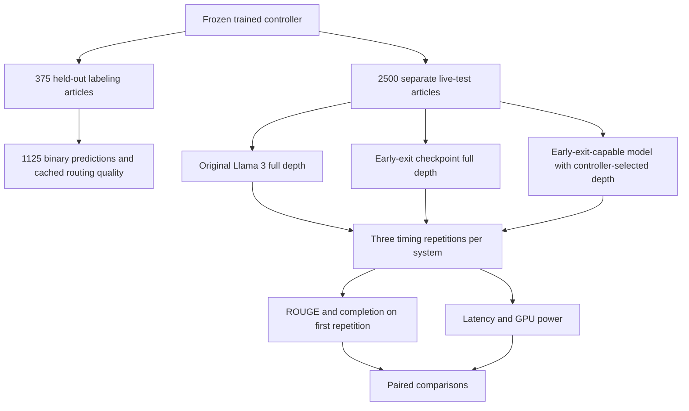

# Evaluation and Results: 2500-Article Run

## Evaluation aims

The evaluation asks whether the trained controller predicts acceptable article-depth outputs and whether its depth choices improve summarization efficiency while preserving quality. The two evaluation sets serve different purposes:

| Evaluation | Data                                                           | Main measurements |
|---|----------------------------------------------------------------|---|
| Controller evaluation | 375 held-out articles, 1125 article-depth labels               | Accuracy, precision, recall, F1, confusion matrix, cached routing metrics |
| Live system test | 2500 separate test articles, three systems, three timing repeats | ROUGE, completion, latency, and GPU power |

## 1. Held-out controller evaluation

The frozen controller was evaluated on 375 articles excluded from training and validation. Each has three candidate depths, giving 1125 binary quality-label predictions. References define the offline labels.

| Metric | Result |
|---|-------:|
| Classification threshold |    0.5 |
| Accuracy | 75.73% |
| Precision | 78.01% |
| Recall | 75.25% |
| F1 | 76.61% |
| True positives |    447 |
| True negatives |    405 |
| False positives |    126 |
| False negatives |    147 |

| Cached routing metric |         Result |
|---|---------------:|
| Depth 24 / 28 / 32 selections | 184 / 129 / 62 |
| Mean depth |        26.6987 |
| Controller ROUGE-L |         0.2427 |
| Full-depth ROUGE-L |         0.2290 |
| Controller ROUGE-L difference |  0.0137 points |

## 2. Live comparison protocol

The live comparison used 2500 separate CNN/DailyMail test articles. Three systems were each run for three timing repetitions: **2500 × 3 × 3 = 22,500 measured generations**, excluding warmups.

| System | Model and inference |
|---|---|
| Original Llama 3 | `meta-llama/Meta-Llama-3-8B`, all 32 layers |
| Early-exit checkpoint full depth | `facebook/layerskip-llama3-8B`, all 32 layers |
| Controller-routed early exit | `facebook/layerskip-llama3-8B`; controller selects 24, 28, or 32 layers |

All systems received identical three-shot prompts and input token IDs, greedy decoding, and the same 192-token output cap. Quality uses the first repetition for 2500 unique articles per system; timing aggregates all three repetitions. Latency includes input transfer, generation, and CPU routing, with GPU synchronization. It excludes loading, tokenization, warmups, ROUGE scoring, and disk writes. Checkpoint order reverses across repetitions, and system execution order alternates by article.

## 3. Live test results

ROUGE values are F1 scores on a 0–1 scale.

| Metric                  | Original Llama 3 baseline | Early-exit checkpoint full depth | Controller-routed early exit |
|-------------------------|--------------------------:|---------------------------------:|-----------------------------:|
| ROUGE-1                 |                    0.3861 |                           0.3872 |                       0.3917 |
| ROUGE-2                 |                    0.1556 |                           0.1567 |                       0.1610 |
| ROUGE-L                 |                    0.2577 |                           0.2592 |                       0.2638 |
| Mean latency/article    |                   1.359 s |                          1.319 s |                      0.841 s |
| Mean depth              |                        32 |                               32 |                       27.264 |
| Mean reported GPU power |                  448.26 W |                         444.26 W |                     408.14 W |

## 4. Paired comparisons

Positive reduction means a saving; a negative reduction means an increase. ROUGE differences are points on the 0–100 scale.

| Metric | Controller vs original base | Controller vs checkpoint full depth | Checkpoint full depth vs original base |
|---|--:|------------------------------------:|---:|
| Time reduction | 38.1% |                               36.2% | 2.9% |
| Speedup | 1.61× |                                1.57 | 1.03× |
| GPU power reduction | 8.95% |                               8.13% | 0.89% |
| ROUGE-L difference | +0.61 points |                        +0.46 points | +0.15 points |

## 5. Evaluation flow

