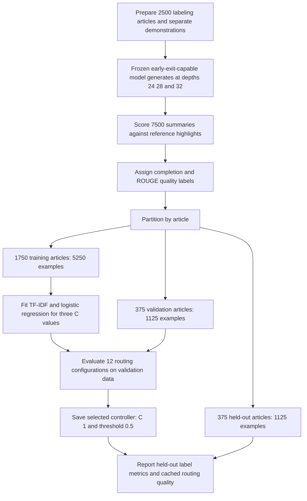
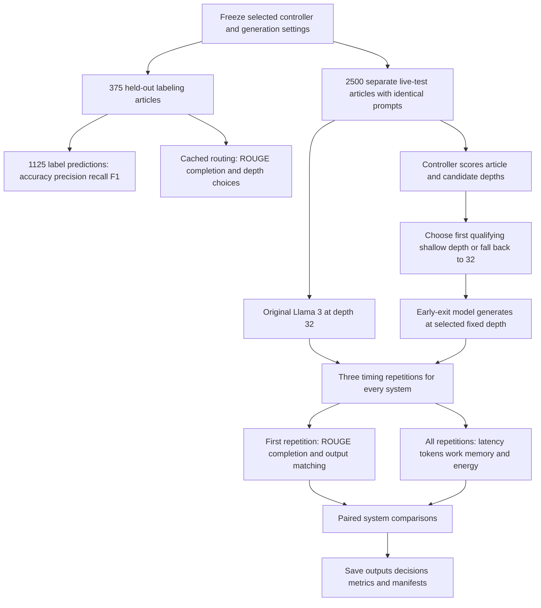

# Methodology: Controller Training and Evaluation

## 1. Study design

This study uses an experimental comparison to investigate whether an article-based controller can select a shallower inference depth for text summarization while preserving summary quality. This document describes the completed **2500-article labeling run and separate 2500-article live test**.

The trainable component is a TF-IDF/logistic-regression controller. The released early-exit-capable Llama 3 8B checkpoint and the original Llama 3 8B model remain frozen. The controller selects a fixed prefix depth of 24, 28, or 32 layers before summary generation. This study uses direct intermediate-depth generation.

## 2. Data preparation

CNN/DailyMail 3.0.0 provides articles and reference highlights. The experiment samples 2500 labeling articles from the original training split and 2500 separate live-test articles from the original test split, using seed 42. Three demonstration articles are kept separate from the labeling articles. The live-test preparation excludes exact normalized duplicates of original training articles, including demonstrations.

Every system receives the same three-shot article-to-summary prompt and precomputed input token IDs. The target reference summary is excluded from the prompt and controller features. The target article is limited to 2,048 tokens; each demonstration article to 1,024 tokens and its summary to 128 tokens. Inputs and the output allowance must fit the 8,192-token context limit. When an article is truncated, the input contains its beginning, while evaluation still uses the original reference highlights.

Generation uses greedy decoding with a 192-token output cap. EOS or the next-article boundary terminates a summary. The completion rule checks the stopping condition, nonempty text, and absence of boundary overrun. A summary stopped by the output cap is scored for ROUGE but fails completion.

## 3. Controller training method

### 3.1 Generate supervision

Each of the 2500 labeling articles is summarized independently with the early-exit-capable Llama 3 8B model at depths 24, 28, and 32. This produces **7500 article-depth examples**. For article i and depth d, let R(i,d) denote reference ROUGE-L F1. The binary target is:

`label(i,d) = 1` if the summary is complete and nonempty, `R(i,d) >= 0.15`, and `R(i,d) >= R(i,32) - 0.02`; otherwise `label(i,d) = 0`.

The 0.15 floor and 0.02 drop allowance are pilot choices for this study. A positive label means the output satisfies this rule; it is not a factual-correctness judgment. Depth 32 can also receive a negative label because of the absolute floor or completion requirement.

### 3.2 Split by article

| Partition | Articles | Depth examples | Use |
|---|---------:|---------------:|---|
| Training |     1750 |           5250 | Fit TF-IDF and classifier |
| Validation |      375 |           1125 | Select controller settings |
| Held-out controller evaluation |      375 |           1125 | Assess the selected controller |

All three depth examples from an article stay in the same partition. The separate 2500-article live test is excluded from controller fitting and setting selection.

### 3.3 Fit features and classifier

The controller input combines visible article text with a candidate-depth token. Word TF-IDF uses unigrams/bigrams and up to 20,000 features; character TF-IDF uses `char_wb` 3–5 grams and up to 20,000 features. Both use sublinear term-frequency scaling. Their concatenated features feed balanced logistic regression with the `lbfgs` solver, a 2,000-iteration cap, and seed 42.

Three classifier fits use C values 0.1, 1, and 10. Each is assessed with routing thresholds 0.5, 0.7, 0.9, and 1.1, giving 12 validation configurations. Selection first prefers configurations with validation mean ROUGE-L drop at most 0.02, then minimizes mean depth. Ties prefer higher mean ROUGE-L, smaller C, and higher threshold. This objective does not impose a separate minimum completion rate or per-article pass rate.

The chosen settings are **C = 1 and threshold = 0.5**. The selected fitted pipeline and metadata are saved as a reusable controller artifact; validation and held-out articles are not added for a final refit.

### 3.4 Training and initial evaluation flowchart

## 4. Evaluation method

### 4.1 Held-out classifier and routing evaluation

The frozen controller predicts the quality label for each of the 1125 held-out article-depth examples. Evaluation reports accuracy, precision, recall, F1, and the confusion matrix at threshold 0.5. These measure the binary quality-label task.

For each of the 375 held-out articles, routing checks the shallow candidates in ascending order and selects the first with predicted positive probability at least the threshold. If neither qualifies, it selects depth 32. The selected depth remains fixed for the whole generation. Cached depth outputs provide routing ROUGE-L, quality-rule pass rate, completion rate, and depth distribution. Cached evaluation supplies no new live latency measurement.

### 4.2 Live system comparison

| System | Checkpoint | Depth policy | Comparison purpose |
|---|---|---|---|
| Original Llama 3 full depth | Original Llama 3 8B | 32 | Original-model reference |
| Controller-routed early exit | Early-exit-capable Llama 3 8B | 24, 28, or 32 | Evaluate learned routing against the base model |

Each system summarizes the same 2500 live-test articles with three timing repetitions: **2500 articles × 2 systems × 3 repetitions = 15,000 measured generations**, plus warmups. Summary-quality results use the first repetition, so the quality sample size remains 2500 articles. Timing and energy aggregate all three repetitions. Output-token consistency is checked across repetitions.

One checkpoint is resident at a time. Checkpoint order reverses across repetitions; baseline and controller-routed execution order alternates by article. These controls reduce order effects. GPU synchronization bounds each timed inference window, and controller routing time is included in reported latency.

### 4.3 Evaluation flowchart

### 4.4 Measurements and calculations

| Measure | Method and interpretation |
|---|---|
| Summary overlap | Stemmed ROUGE-1, ROUGE-2, and ROUGE-L F1 against reference highlights, on a 0–1 scale |
| Completion | Fraction meeting the stopping/nonempty-output rule |
| Quality-rule pass rate | Fraction passing completion, absolute ROUGE-L floor, and allowed drop against the stated baseline |
| Classifier metrics | Accuracy, precision, recall, F1, and TP/TN/FP/FN on held-out quality labels |
| Latency | Total, mean; includes input transfer, generation, and CPU routing |
| Output tokens | Generated token count including EOS/boundary tokens; tokenization is outside latency |
| Throughput | Generated tokens divided by measured inference seconds |
| Depth | Mean selected depth and counts for 24, 28, and 32 |
| Estimated work | `depth × (input tokens + generated tokens - 1)`; a layer-token proxy |
| GPU energy | AMD SMI cumulative-energy counter difference over the synchronized inference window, in joules |
| GPU power | Reported average power during inference windows, in watts |

For baseline B and candidate C:

- `reduction (%) = 100 × (1 - C / B)` for time, output tokens, estimated work, and energy. A negative value means an increase.
- `speedup = baseline time / candidate time`.
- `ROUGE difference (points) = 100 × (candidate mean - baseline mean)`.

Latency excludes model loading, downloads, warmups, input tokenization, ROUGE computation, and disk writes. All 32 layers' weights stay resident. Energy uses whole-device readings without idle subtraction. The saved run's energy telemetry requires interpretation in light of the GPU environment and counter support.
