# Research Focus

## Research title

**Predicting Adaptive Inference Depth for Large Language Model Text Summarization: A Controller-Based Study**

## Research problem

Running every summarization request through all model layers can spend computation on examples that may be adequately summarized at a shallower depth. This investigates whether a lightweight controller can predict an acceptable depth from the input article and whether that routing produces a useful efficiency change while preserving summary quality.

## Research questions

1. **RQ1:** Can a controller trained on article text predict an inference depth (24, 28, or 32 layers) for an early-exit-capable Llama 3 8B model that satisfies the predefined summary-quality rule?
2. **RQ2:** Under the same prompts, inputs, and generation settings, how does controller-routed early-exit inference compare with the full-depth Llama 3 8B base model in summary quality, measured by ROUGE-1/2/L and completion rate?
3. **RQ3:** What efficiency differences are observed between controller-routed early-exit inference and the full-depth Llama 3 8B base model in estimated layer-token work, latency, GPU memory, and measured GPU energy?

## Research objectives

### Main objective

To implement and evaluate a controller that selects an inference depth for summarization with an early-exit-capable Llama 3 8B model, measuring the resulting quality and efficiency against the full-depth Llama 3 8B base model.

### Specific objectives

1. Prepare CNN/DailyMail 3.0.0 articles and reference highlights, keeping controller training, validation, and test articles separate at the article level.
2. Generate training-label summaries at 24, 28, and 32 layers with the early-exit-capable Llama 3 8B model, assign labels using the predefined completion and ROUGE-L quality rule, and train and evaluate a separate word- and character-level TF-IDF plus balanced logistic-regression controller to select a depth from article text.
3. Evaluate controller-routed early-exit inference against the full-depth Llama 3 8B base model using identical prompts and generation limits, reporting summary quality, controller label metrics, output tokens, estimated layer-token work, latency, GPU memory, and GPU energy with the limits of each measure.

## Controller–model architecture

```mermaid
flowchart LR
    subgraph FIT[Offline controller fitting]
        A[Training articles and reference highlights] --> B[Early-exit-capable Llama 3 8B checkpoint<br/>frozen model weights]
        B --> C[Generate summaries at depths 24 28 and 32]
        C --> D[Create binary labels<br/>completion and ROUGE-L rule]
        D --> E[Fit word and character TF-IDF vocabularies]
        E --> F[Fit balanced logistic-regression controller<br/>trainable component]
    end

    subgraph RUN[Inference for a new article]
        G[Article text] --> H[Build candidate features<br/>article text plus depth token]
        H --> I[TF-IDF transforms and fitted controller]
        I --> J[Select fixed depth d<br/>24 28 or 32]
        G --> N[Build model prompt and input tokens]
        subgraph MODEL[Early-exit-capable Llama 3 8B · frozen weights]
            X[Internal depth selector<br/>receives controller choice]
            N --> O[Input embeddings]
            O --> P[Transformer blocks 1–24]
            P --> Q{Exit at 24?}
            Q -->|No| R[Transformer blocks 25–28]
            R --> S{Exit at 28?}
            S -->|No| T[Transformer blocks 29–32]
            T --> U[Exit at 32]
            Q -->|Yes| V[Shared LM head]
            S -->|Yes| V
            U --> V
            V --> M[Generate summary]
            X -. d = 24 .-> Q
            X -. d = 28 .-> S
            X -. d = 32 .-> U
        end
        J -. selected depth .-> X
    end

    F -. saved fitted pipeline .-> I
```

The controller sends a fixed depth choice to an internal cutoff in the model. The forward pass stops at that selected layer boundary, and the selected layer output continues through the shared language-model head. The controller is fitted for this study; the Llama weights remain frozen.

## Contributions

This study makes four contributions:

- applies the project's separate-controller approach to text summarization;
- documents a reproducible pipeline for creating article-depth quality labels, training and evaluating the controller, and testing on a separate article set;
- evaluates controller-routed early-exit inference against the full-depth Llama 3 8B base model on the same 2500-article test set; and
- reports quality and efficiency together, distinguishing measured latency and energy from estimated layer-token work and discussing the limits of article-level TF-IDF for predicting per-depth summary quality.
