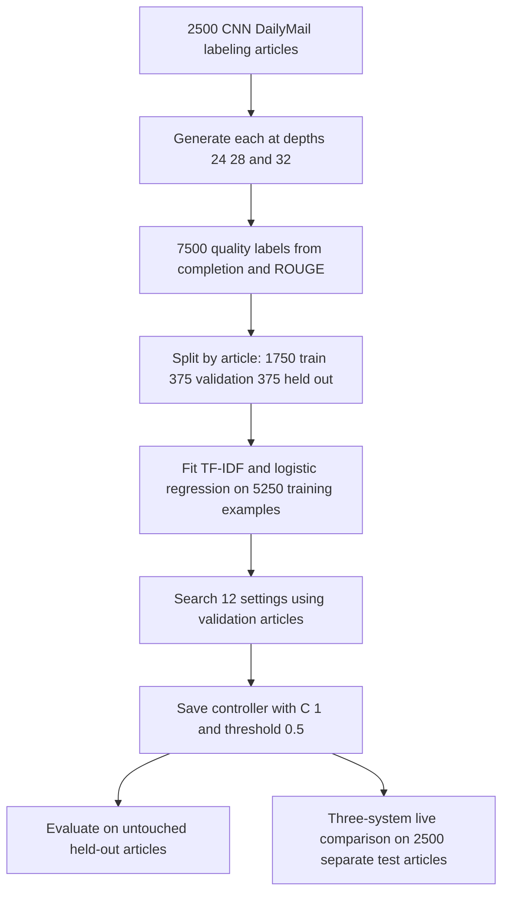

# Controller Training: 2500-Article Run

## What was trained

This study trained a separate CPU controller to predict whether a candidate inference depth for the early-exit-capable model would meet a summary-quality rule. Both language models stayed frozen. Training used visible article text plus a depth token, not reference summaries as input features.

## Data and labels

CNN/DailyMail 3.0.0 supplied 2500 labeling articles. Each article was independently summarized at depths 24, 28, and 32, producing 7,500 article-depth examples. These are three generations per article, not 7,500 distinct articles.

A positive label requires a nonempty, complete summary, reference ROUGE-L F1 ≥ 0.15, and ROUGE-L no more than 0.02 below the same article's depth-32 output. These are project-defined pilot rules; they do not establish factual correctness.

| Depth | Positive labels / 2500 |  Mean ROUGE-L |
|---|-----------------------:|---:|
| 24 |                   1367 |  0.2411 |
| 28 |                   1415 | 0.2489 |
| 32 |                   1384 | 0.2455 |

Articles were split before expanding them into depth examples, preventing the same article from appearing in multiple controller partitions.

| Partition | Articles | Article-depth examples | Purpose |
|---|---------:|-----------------------:|---|
| Training |     1750 |                   5250 | Fit features and classifier |
| Validation |      375 |                   1125 | Select regularization and routing threshold |
| Held-out evaluation |      375 |                   1125 | Evaluate the frozen controller |
| Total |     2500 |                   7500 | Controller development dataset |

A separate 2500-article test set was reserved for a three-system live comparison: original Llama 3 at full depth, the early-exit-capable checkpoint at full depth, and the same checkpoint with controller-selected depth.

## Training method

| Setting | Recorded method |
|---|---|
| Word features | TF-IDF word unigrams/bigrams; maximum 20,000 features |
| Character features | TF-IDF `char_wb` 3–5 grams; maximum 20,000 features |
| Term-frequency scaling | Sublinear |
| Classifier | Logistic regression with balanced class weights |
| Solver / iteration cap | `lbfgs` / 2,000 iterations |
| Seed | 42 |
| Regularization search, C | 0.1, 1.0, 10.0 |
| Routing threshold search | 0.5, 0.7, 0.9, 1.1 |
| Selected settings | C = 1.0; threshold = 0.5 |

The search assessed 12 setting combinations. It first preferred settings within the validation mean ROUGE-L drop budget (0.02), then minimized mean selected depth; ties preferred higher ROUGE-L, smaller C, and higher threshold. Routing tries shallower candidate depths and falls back to depth 32 when neither qualifies. Threshold 1.1 forces that fallback. The selected pipeline was saved without fitting again on validation or held-out articles.

## Training flow

