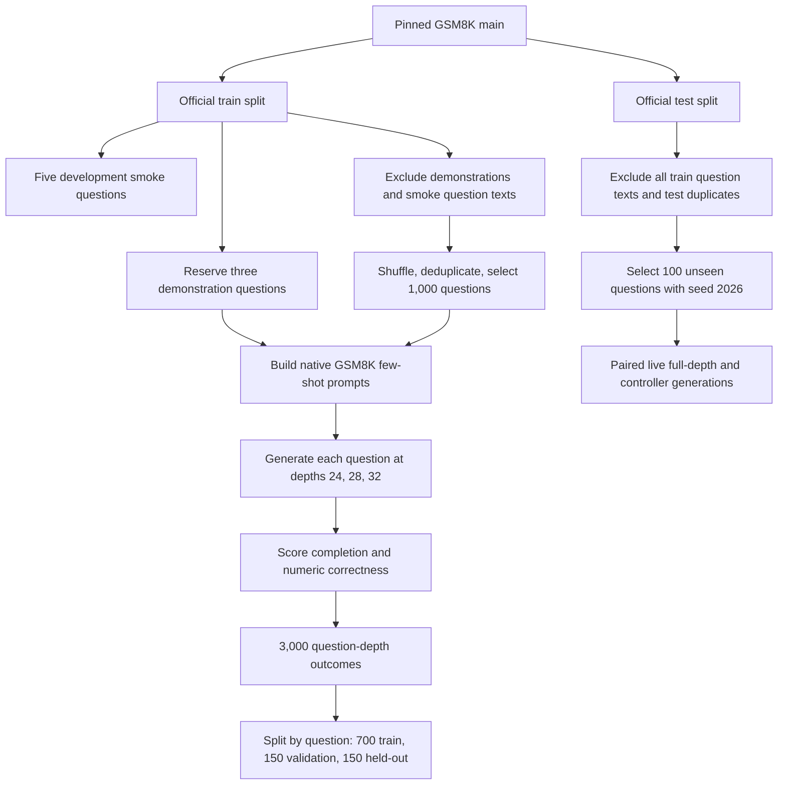

# V5 datasets and data preparation

This document covers only the datasets used by V5. GSM8K is the source dataset. V5 derives question-depth outcome records from it to train and evaluate a separate text controller for `facebook/layerskip-llama3-8B`.

## Source dataset

| Item | V5 use |
|---|---|
| Dataset | `openai/gsm8k`, configuration `main`, loaded through Hugging Face Datasets |
| Pinned controller dataset revision | `740312add88f781978c0658806c59bc2815b9866` |
| Official training split | Few-shot demonstrations, development smoke questions, and controller labeling questions |
| Official test split | Final live comparison of full-depth generation and controller-guided generation |
| Question field | Model prompt and controller input |
| Answer field | Worked demonstrations and reference scoring; the reference final number follows `####` |

Source: [GSM8K dataset](https://huggingface.co/datasets/openai/gsm8k). The source paper and repository are recorded in [citations.md](citations.md). No other task dataset is loaded by the V5 workflow.

## How V5 uses the data

### Development smoke data

The default smoke test selects five questions from GSM8K train using seed 42: source indices 1458, 3620, 6312, 4833, and 5032. Each is generated at depths 24, 28, and 32, giving 15 measured generations. Three training examples with different normalized question texts provide demonstrations.

The optional self-speculative comparison reuses the smoke run's exact questions and demonstrations. These small development sets help inspect model behavior; they are not the controller's final unseen test.

### Current controller labeling data

The current controller protocol is `v5-question-depth-outcome-controller-24-28-32-v3-gsm8k-prompt`.

1. Load the pinned GSM8K training split.
2. Reserve its first three examples as demonstrations.
3. Exclude those demonstration question texts and the five smoke question texts.
4. Shuffle source indices using seed 42. Keep unique eligible question texts.
5. Select the requested number of questions: 1,000 by default.
6. Generate once at each depth: 24, 28, and 32. Rotate depth order between questions.
7. Save the generation evidence and its observed outcome for every question-depth pair.

The current prompt shows each demonstration as `Question: ...` followed by the original worked `Answer: ... #### number`. It ends the new question with `Answer:`. The current question's reference solution and final answer are kept for scoring and are not supplied in the prompt.

The resulting 1,000-question collection contains 3,000 measured question-depth outcomes. It retains wrong and incomplete outputs rather than filtering for questions that full depth solves. There is no requirement to balance labels or target depths.

### Label definition

For each question and candidate depth:

```text
label = 1  if generation is complete and its extracted final number equals the reference
label = 0  otherwise
```

Generation is greedy, with a default cap of 1,024 new tokens. The scoring code accepts an explicit `####` or `FINAL:` numeric marker. It compares numbers using Decimal after removing commas. Missing markers, wrong answers, token-cap termination, and detected continuation into a subsequent question count as unsuccessful. Valid completion is EOS or a clean next-question boundary.

A label describes one observed outcome at one depth. It does not establish that the depth is reliably safe, and it is not a sentence-removability or reasoning-token label.

### Controller partitions

Questions are shuffled with the training seed and divided 70%/15%/15%. All three depth outcomes for one question stay in the same partition. Despite the helper name `stratified_partitions`, the implementation is a shuffled split by question ID; it does not stratify outcome classes.

| Partition | Questions for a 1,000-question collection | Question-depth examples | Purpose |
|---|---:|---:|---|
| Training | 700 | 2,100 | Fit TF-IDF vocabulary and logistic regression |
| Validation | 150 | 450 | Select regularization by routed answer accuracy |
| Internal held-out test | 150 | 450 | Evaluate the frozen classifier and routing on saved outcomes |

These are subdivisions of GSM8K train. The internal held-out test is distinct from the official GSM8K test split.

### Unseen live-test data

The live tester selects 100 questions by default from GSM8K test using seed 2026. It excludes normalized question texts appearing anywhere in GSM8K train, and removes duplicates within the selected set. Selection does not depend on correctness, predicted safety, or class balance.

Each selected question gets two new generations: one at depth 32 and one at the depth chosen by the frozen controller. This gives 200 measured generations for 100 questions. Both conditions reuse the demonstrations and generation settings saved in the controller checkpoint.

## Data flowchart



## Saved data and traceability

| Artifact | Contents |
|---|---|
| `labels/questions.json` | Selected labeling questions and references |
| `labels/demonstrations.json` | Exact three prompt examples |
| `labels/questions/<id>/prompt.json` | Exact prompt for the question |
| `labels/questions/<id>/depth_<N>.json` | Generated tokens/text, extracted answer, completion, correctness, time, and memory |
| `labels/selected_dataset.json` | Question records with all three outcomes and per-trial SHA-256 hashes |
| `labels/manifest.json` | Dataset/model revisions, settings, code hashes, environment, and identity |
| `training/splits.json` | Exact records assigned to each controller partition |
| `unseen-test/questions.json` | Official-test questions selected for the live comparison |

A record preserves its question ID, source index, normalized question hash, question text, reference solution, and reference answer. Before training, the loader validates manifest identity, unique questions, all three outcomes, and trial checksums.

## Current protocol versus existing results

The checked-in live-test manifest under `v5/results/unseen-test/unseen-test/` records the older `...-v2` controller protocol. The current source uses the native GSM8K prompt protocol above. Earlier custom-prompt labels and results must be identified separately; they do not demonstrate completion or performance of the current 1,000-question collection.

Implementation sources: `v5/smoke.py`, `v5/controller_common.py`, `v5/controller_label.py`, and `v5/controller_test.py`. See [training](traning.md) and [evaluation](evaluation.md) for downstream use.

