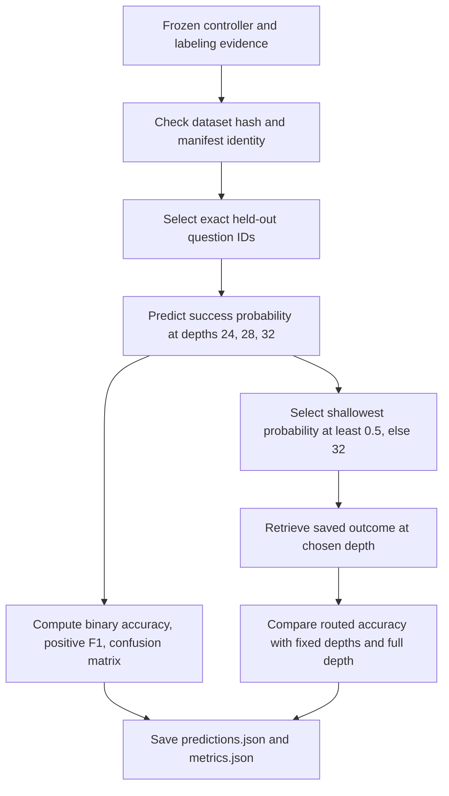
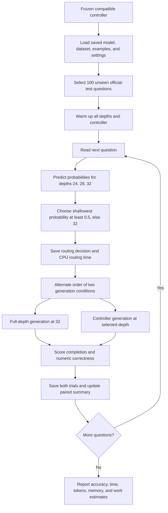

# V5 controller evaluation and live testing

V5 evaluates the frozen controller in two stages: an internal held-out evaluation using previously generated outcomes, followed by a live comparison on unseen GSM8K test questions. These answer different questions: prediction and routing quality on labeled evidence, and the accuracy/runtime tradeoff when the controller actually chooses a generation depth.

The procedures below describe the current controller source protocol, `v5-question-depth-outcome-controller-24-28-32-v3-gsm8k-prompt`. They document how to run evaluation and testing; creating this document does not execute a new GPU experiment.

## 1. Internal held-out evaluation

### Inputs and isolation

The evaluator loads the trained `controller.joblib` and the original labeling directory. It verifies that the controller's labeling manifest identity and dataset SHA-256 match the supplied evidence. It selects only the exact held-out question IDs saved during training.

For a 1,000-question labeling collection, this partition has 150 questions and 450 question-depth outcomes. The controller is already frozen; the held-out results do not select regularization or alter the routing threshold.

### Evaluate classification and routing

For every held-out question, the classifier predicts the probability of a complete correct answer separately at depths 24, 28, and 32. A probability at least 0.5 predicts label 1.

The routing rule chooses the shallowest depth whose score reaches 0.5, or depth 32 if none does. The evaluator retrieves the saved generation outcome for the chosen depth to determine routed answer accuracy. No new language-model generation occurs in this stage.

| Output | Meaning |
|---|---|
| Binary accuracy | Correct safe/unsafe predictions across question-depth examples |
| F1 for answer-preserved class | F1 with complete-and-correct outcomes as positive label 1 |
| Confusion matrix | True classes in rows, predicted classes in columns; order is 0 then 1 |
| Routed answer accuracy | Fraction of held-out questions correct at the chosen depth |
| Full-depth answer accuracy | Fraction correct at depth 32 on those same questions |
| Correct-to-wrong count | Full-depth-correct answers that routing changes to unsuccessful outcomes |
| Selected-depth counts and mean depth | How often and how deeply the controller routes |
| Fixed-depth accuracies | Accuracy of depths 24, 28, and 32 separately on identical questions |

These are cached-outcome results. They do not measure live controller overhead or establish a new latency speedup. Some source strings still describe a “100-question pilot”; use the actual counts in the artifacts for the run being reported.

### Internal evaluation flowchart



## 2. Live use of the controller on unseen questions

### Test selection and compatibility

The live tester draws 100 questions by default from the official GSM8K test split, with seed 2026. It excludes normalized texts from the entire training split and excludes duplicates. Selection does not filter questions by full-depth correctness or predicted safety.

It loads the model revision, dataset revision, demonstrations, generation cap, and generation seed recorded in the controller. It also checks the saved common-generation and smoke-code hashes against the current files, rejecting an incompatible checkpoint. Old-protocol controllers require their matching archived source.

### Paired test procedure

1. Load the frozen controller and select/save unseen questions.
2. Load `facebook/layerskip-llama3-8B` at the controller's recorded revision.
3. Warm up generation at all three depths and warm up controller routing.
4. For each question, predict success probabilities using question text and candidate depth markers, then save the selected depth and routing time before answer generation.
5. Generate one full-depth answer at depth 32 and one controller-guided answer at the selected depth. Alternate which condition runs first by question index.
6. Use identical demonstrations and greedy generation settings in both conditions. The default cap is 1,024 new tokens.
7. Score both answers, save each trial immediately, and update the paired summary.

The controller supplies a depth, not an answer. Generation runs only the selected initial transformer blocks while retaining the checkpoint's final normalization and output head. That depth is fixed for the prompt and all new tokens. The live controller test uses direct exits, without speculative draft verification.

### Answer scoring

A successful answer must be complete and its explicitly marked final number must match the GSM8K reference numerically. The current parser accepts `####` or `FINAL:` markers; the current prompt uses native GSM8K demonstrations ending with `#### number`.

EOS or a clean next-question boundary is accepted as completion. Missing numeric markers, wrong numbers, length-cap termination, and boundary overrun are unsuccessful. The system compares final answers and does not verify every intermediate reasoning step.

### Live testing flowchart



## 3. Measurements and interpretation

| Measure | How V5 reports it |
|---|---|
| Accuracy and completion | Correct/complete counts and accuracy for each condition |
| Runtime | Synchronized generation timing plus controller routing time for the controller condition |
| Mean time | Total measured condition time divided by question count |
| Tokens and throughput | Input/output totals and aggregate output tokens per measured second |
| Routing | Counts selected at 24, 28, and 32 |
| GPU memory | Maximum per-trial PyTorch allocated and reserved memory |
| Paired answer changes | Correct-to-wrong and wrong-to-correct counts relative to full depth |
| Paired speed ratio | Full-depth generation seconds divided by controller generation plus routing seconds |
| Work estimate | Sum of depth × (input tokens + max(output tokens − 1, 0)) |

Generation timing includes prompt construction, tokenization, input transfer, fixed-depth setup, and synchronized generation. Model/dataset loading, warmup, answer decoding/scoring after the timer, and artifact writes are excluded. Controller inference time is measured separately and added to the controller total.

Layer-token work estimates are not hardware FLOP or energy measurements. All model weights remain resident; a lower selected depth need not reduce peak memory. Different answer lengths also affect time and work. A controller-selected depth of 32 still receives its own generation in the paired experiment.

## 4. Run evaluation and live testing

Run from the repository root in the configured V5 environment, after the current protocol's labeling and training stages finish.

```bash
export CTRL_RUN=/root/pssn-work/PSSN2/v5/controller-1000x3

python -m v5.controller_evaluate \
  --labels-dir "$CTRL_RUN/labels" \
  --controller "$CTRL_RUN/training/controller.joblib" \
  --output-dir "$CTRL_RUN/evaluation"

python -m v5.controller_test \
  --controller "$CTRL_RUN/training/controller.joblib" \
  --output-dir "$CTRL_RUN/unseen-test" \
  --rows 100 --seed 2026
```

The live stage requires the configured GPU environment and access to the gated checkpoint. Repeating a compatible live-test command resumes saved trials. Settings, code, or environment changes require a new output directory. The full server setup and stage-backup commands are in `v5/CONTROLLER_1000X3_SERVER.md`.

## 5. Saved evaluation and test artifacts

| Location | Contents |
|---|---|
| `evaluation/predictions.json` | Per-depth probabilities, predicted/observed outcomes, and selected depths |
| `evaluation/metrics.json` | Held-out classification, routing, and fixed-depth metrics |
| `evaluation/manifest.json` | Controller checksum and labeling evidence hash |
| `unseen-test/questions.json` | Actual selected official-test questions and references |
| `unseen-test/questions/<id>/decision.json` | Frozen routing decision, probabilities, and routing time |
| `unseen-test/questions/<id>/full_depth.json` | Live depth-32 generation and measurements |
| `unseen-test/questions/<id>/controller.json` | Live generation at the selected depth and measurements |
| `unseen-test/summary.json` | Running/final condition metrics and paired comparisons |
| `unseen-test/manifest.json` | Model/data revisions, checkpoint/code hashes, settings, and environment |

## 6. Existing results and reporting limits

The checked-in `v5/results/unseen-test/unseen-test/manifest.json` identifies an earlier `...-v2` protocol, not the current native-prompt protocol. Its summary reports 39/100 full-depth-correct answers and 33/100 controller-correct answers, with 212.31 s versus 187.49 s including routing. It records nine correct-to-wrong and three wrong-to-correct changes. The narrative `research/progress-report-v5.md` gives conflicting accuracy figures, so those figures need reconciliation with the underlying trials before publication.

These older outcomes must not be presented as results of the current 1,000-question training protocol. A new evaluation should report its exact manifest, checkpoint, counts, prompt, and settings. One greedy outcome per question and a small live test support an exploratory tradeoff analysis; uncertainty estimates and larger repeated evaluations are needed for a strong accuracy-preservation claim.

The separate five-question `v5.compare_self_speculative` experiment compares full-depth greedy output with verified self-speculative decoding. It does not test the question controller and should be reported as a separate condition.

Implementation sources: `v5/controller_evaluate.py`, `v5/controller_test.py`, and `v5/controller_common.py`. See [dataset.md](dataset.md) and [traning.md](traning.md) for preparation and training.

