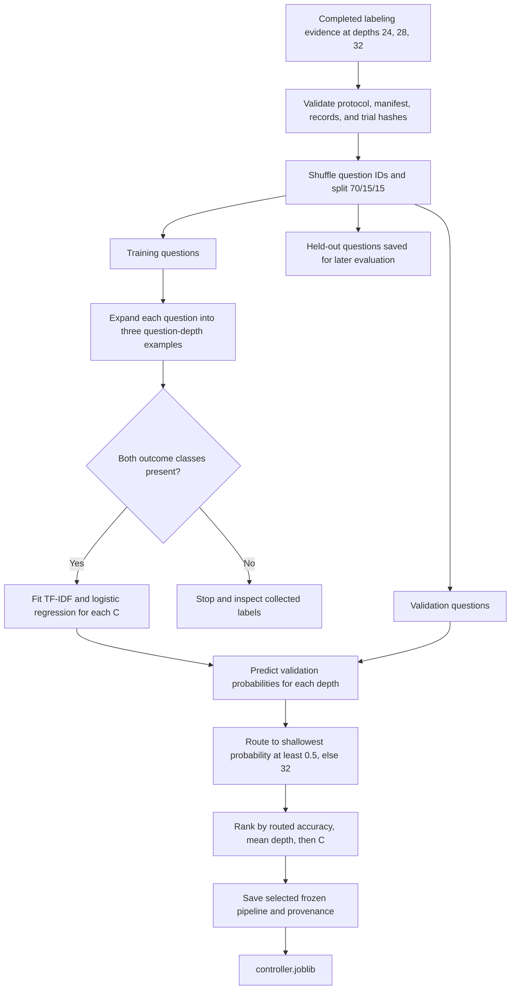

# V5 controller training

V5 trains a CPU text classifier to predict whether a question will receive a complete, correct answer at a candidate LayerSkip depth. The released LayerSkip language model stays frozen. Controller training uses measured question-depth outcomes, not gradients or hidden-state features from the language model.

This document describes the current source protocol: `v5-question-depth-outcome-controller-24-28-32-v3-gsm8k-prompt`. The filename `traning.md` follows the requested spelling.

## Training inputs and labels

The input is a completed labeling directory containing `selected_dataset.json`, its manifest, demonstrations, and the underlying generation trials. Each question has one observed generation at depths 24, 28, and 32.

The binary target is 1 for a complete numerically correct answer and 0 for a wrong or incomplete answer. All questions remain eligible even when depth 32 fails. The classifier is not trained to copy a single oracle target depth or to preserve the full-depth output text.

Before fitting, the loader checks the protocol, manifest identity, configured question count, unique normalized question keys, all three depths, trial checksums, and agreement between dataset outcomes and trial evidence.

## Partitioning

With the default training seed 42, question IDs are shuffled and divided 70%/15%/15%. Every depth example from one question remains in its assigned partition.

| Partition | Questions at the current 1,000-question setting | Expanded examples | Use |
|---|---:|---:|---|
| Training | 700 | 2,100 | Fit vocabulary, IDF weights, and classifier |
| Validation | 150 | 450 | Select the regularization setting |
| Held-out test | 150 | 450 | Used later by the evaluation script |

The split is grouped by question but not stratified by label. Training stops if the training partition contains only one outcome class.

## Features and classifier

Each question is expanded into three input strings:

```text
<question text> [DEPTH_24]
<question text> [DEPTH_28]
<question text> [DEPTH_32]
```

The depth marker is processed as text by the feature pipeline. The reference answer, worked solution, generated response, observed label, and timing are excluded from the feature string.

| Component | Current implementation |
|---|---|
| Word features | TF-IDF word unigrams and bigrams; at most 20,000 features |
| Character features | TF-IDF character n-grams of length 3–5 within word boundaries; at most 20,000 features |
| TF scaling | Sublinear term frequency in both branches |
| Combination | Concatenate the word and character feature matrices with FeatureUnion |
| Classifier | Logistic regression, LBFGS solver |
| Class weighting | `balanced`, based on the training labels |
| Iteration limit | 2,000 iterations |
| Candidate regularization | `C = 0.1, 1.0, 10.0` |
| Default random seed | 42 |

Each candidate pipeline is fitted only on the training partition. The code does not tune the language model or use a neural controller with epochs and a learning rate.

## Validation and model selection

For every regularization candidate, the pipeline predicts the probability of label 1 for each candidate depth on each validation question. Routing chooses the shallowest depth with probability at least 0.5. If no depth reaches the threshold, routing chooses 32.

The candidate models are ranked by:

1. Highest validation routed answer accuracy, measured using the saved generation outcome at the selected depth.
2. Lowest mean selected depth when accuracy is tied.
3. Smallest regularization value C when both are tied.

Binary question-depth prediction accuracy is also logged, but it is not the selection objective. The probability threshold stays fixed at 0.5; the code does not search thresholds.

The selected pipeline is saved with its training-only fit. It is not refitted on combined training and validation data. The held-out test partition does not select the model.

## Training flowchart



## Frozen controller and routing

The saved controller contains the fitted vocabulary, IDF weights, classifier, model/dataset revisions, demonstrations, generation cap and seed, split IDs, excluded labeling-question keys, and code/evidence hashes.

For a new question, it calculates three probabilities and selects a depth before answer generation. That selected depth is fixed throughout prompt processing and decoding. A score above 0.5 is a prediction of an observed successful outcome, not a calibrated safety guarantee. Falling back to depth 32 does not guarantee correctness either.

## Run training

Run from the repository root in the configured V5 environment after labeling has completed. Set the path to a new run directory for the current prompt protocol.

```bash
export CTRL_RUN=/root/pssn-work/PSSN2/v5/controller-1000x3

python -m v5.controller_train \
  --labels-dir "$CTRL_RUN/labels" \
  --output-dir "$CTRL_RUN/training" \
  --seed 42
```

## Training outputs

| Artifact | Contents |
|---|---|
| `training/controller.joblib` | Frozen pipeline, generation settings, demonstrations, split IDs, and provenance |
| `training/splits.json` | Exact question records in training, validation, and held-out partitions |
| `training/validation_search.json` | Metrics for each regularization candidate |
| `training/training_summary.json` | Counts, class balance, selected validation model, and controller checksum |
| `training/manifest.json` | Training configuration, input evidence identity, code hashes, and environment |
| `training/run_status.json` | Progress and completion/failure status |

The current workflow documents a 1,000-question run. The earlier progress report describes a smaller 100-question pilot; its selected model and metrics must not be presented as outcomes of the current larger protocol.

Implementation sources: `v5/controller_train.py` and `v5/controller_common.py`. See [dataset.md](dataset.md) for label construction and [evaluation.md](evaluation.md) for evaluation and live use.

