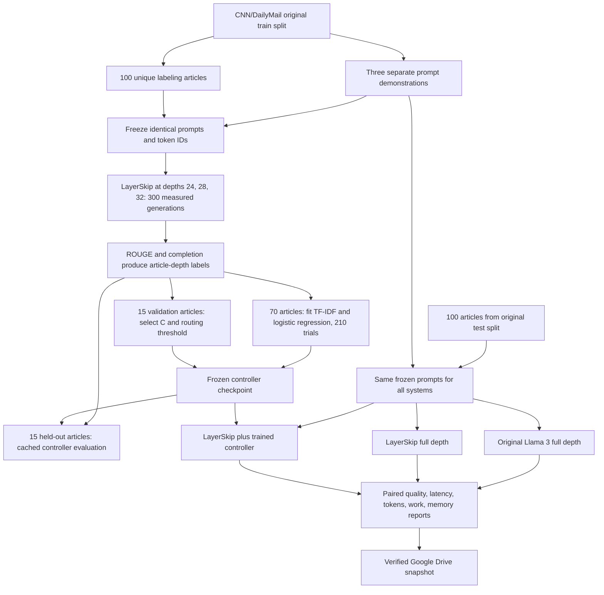

# V6: text summarisation controller, 100 articles × 3 depths

V6 keeps V5's TF-IDF + balanced logistic regression training method and direct
prefix depths **24 / 28 / 32**, and replaces GSM8K with **CNN/DailyMail 3.0.0**.
The controller sees the visible article text and predicts an acceptable exit
depth before generation. Both language models stay frozen.

Follow [SERVER_SETUP.md](SERVER_SETUP.md) for the complete GPU run and
[DRIVE_SAVE.md](DRIVE_SAVE.md) for Google Drive configuration, snapshots and restore.

## Experiment

| System | Weights | Inference |
|---|---|---|
| `base_full` | `meta-llama/Meta-Llama-3-8B` | All 32 layers |
| `layerskip_full` | `facebook/layerskip-llama3-8B` | All 32 layers |
| `layerskip_controller` | Same LayerSkip checkpoint | New controller selects 24, 28 or 32 |

The second versus first comparison measures the difference associated with the
released LayerSkip checkpoint. The third versus second isolates controller
routing on that checkpoint. The third versus first measures the combined change.
These are base/completion checkpoints, not summarisation-specific fine-tunes.
V6 does not fine-tune either LLM and does not implement LayerSkip's verified
self-speculative decoding. Direct early exits can change output quality.



100 × 3 means **100 distinct articles, each independently generated at all three
depths**. The 70/15/15 split stays at article level, so trials from the same
article never appear in different controller partitions. Demonstrations are
separate from all 100 labeling articles. The live test excludes exact normalized
duplicates of any original training article, including the demonstrations.

The live test defaults to three timing repetitions: 100 articles × 3 systems ×
3 repeats = **900 measured generations**, plus warmups. ROUGE is averaged over
100 unique articles using repetition zero; repeated timings do not increase the
quality sample size. Use `--repeats 1` for a shorter 300-generation pilot.

## Prompt and labels

All systems receive the same three `Article: ... / Summary: ...` demonstrations
and exactly the same input token IDs. The target reference summary never enters
the prompt or controller features. Tokenizer vocabulary compatibility is checked
before model comparison. Greedy decoding uses the same EOS, stop rule and
192-token output cap across systems; a new `Article:` stops the continuation.

Defaults retain up to 2,048 tokens of the target article, up to 1,024 tokens per
demonstration article, and 128 tokens per demonstration summary. Original full
articles and references are also saved. Truncation is explicit, counted, and
uses the article beginning; ROUGE still compares against the original reference.
Thus truncated cases evaluate summarisation from the visible excerpt, not from
an unseen full article. Inputs plus output cap must fit 8,192 tokens.

A quality label is positive when the observed summary:

1. Ends at EOS or the next-article boundary without overrun, and is nonempty.
2. Has reference ROUGE-L F1 at least **0.15**.
3. Has reference ROUGE-L F1 no more than **0.02** below the same article's
   full-depth LayerSkip output.

Both numbers are **initial experimental choices**, not established research
standards. Freeze them before testing. `0.02` is two points on the 0–100 ROUGE
scale. A capped summary is scored for ROUGE but gets a negative completion label.
Full-depth generations can also fail the completion/absolute-quality rule.
Label proportions and complete rates should be inspected before training.

The classifier uses the same word and character TF-IDF features as V5. It fits
only the 210 training trials. Validation chooses C from 0.1/1/10 and routing
threshold from 0.5/0.7/0.9/1.1. It minimizes selected depth within the validation
mean ROUGE-L loss budget, with quality as a tie-breaker. A threshold of 1.1
explicitly selects the full-depth fallback. Reference summaries are used for
offline labels and evaluation only, never for live routing. A single-class
training split raises an explanatory error rather than claiming a trained model.

## Measurements

| Measurement | Meaning |
|---|---|
| ROUGE-1 / ROUGE-2 / ROUGE-L F1 | Mean reference overlap, reported on a 0–1 scale |
| ROUGE delta points | 100 × (candidate mean − baseline mean) |
| Quality rule pass rate | Fraction meeting the stated completion, floor and loss rule |
| Total / mean / p50 / p95 latency | Input transfer + generation + controller routing |
| Speedup | Paired baseline seconds / candidate seconds |
| Time reduction % | 100 × (1 − candidate seconds / baseline seconds) |
| Output token reduction % | 100 × (1 − candidate generated tokens / baseline generated tokens) |
| Output tokens/second | Generated tokens / measured inference seconds |
| Estimated layer work | depth × (input tokens + generated tokens − 1) |
| Work reduction % | Same reduction formula applied to estimated layer-token work |
| Depth distribution | Number of articles routed to 24 / 28 / 32 |
| Peak GPU allocated / reserved memory | PyTorch allocator peaks, not whole-device power or energy |
| GPU energy (joules) and average GPU power (watts) | AMD SMI cumulative energy-counter delta during each synchronized inference window; `n/a` if unsupported |
| Repeat consistency | Count of token sequences that differ across timing repeats |
| Paired bootstrap intervals | 95% intervals for ROUGE-L and latency deltas, resampling articles |

Input tokenization, model loading, downloads, warmups, ROUGE scoring and disk
writes are outside the latency boundary. All input IDs are precomputed. CPU
routing time is included for the controller. Runs use synchronized GPU timings,
one resident checkpoint at a time, reversed checkpoint order on alternate
repetitions, and alternating LayerSkip full/controller order by article.

Early exit reduces layers per token; it does **not necessarily reduce generated
tokens**. Negative savings mean an increase. All generated tokens, including EOS
or boundary tokens, count toward output length. A short, incomplete or inaccurate
summary is not an efficiency success. All 32 layers' weights stay on the GPU,
so depth routing does not imply model-weight memory reduction. Layer work is a
proxy, not a FLOP measurement. Energy is a whole-device measurement with no
idle-energy subtraction; another GPU workload can affect it. It does not imply
monetary savings.

`controller_evaluate` reports binary classifier accuracy/precision/recall/F1 on
45 held-out article-depth labels. That accuracy describes predicting the quality
rule; it is not a percentage of factually correct summaries. Threshold 1.1 can
produce all-negative classifier predictions while routing safely falls back to 32.

## Commands and saved evidence

Run these from the repository root in the prepared server environment:

```bash
python -m v6.prepare --output-dir "$V6_RUN/prepared" --rows 100 --test-rows 100
python -m v6.controller_label --prepared-dir "$V6_RUN/prepared" --output-dir "$V6_RUN/labels"
python -m v6.controller_train --labels-dir "$V6_RUN/labels" --output-dir "$V6_RUN/training"
python -m v6.controller_evaluate --labels-dir "$V6_RUN/labels" --controller "$V6_RUN/training/controller.joblib" --output-dir "$V6_RUN/evaluation"
python -m v6.controller_test --prepared-dir "$V6_RUN/prepared" --controller "$V6_RUN/training/controller.joblib" --output-dir "$V6_RUN/comparison" --repeats 3
```

Each generation is saved immediately and reused only when its identity matches.
Manifests freeze settings, resolved model/data commit IDs, source hashes, package
versions and GPU metadata. Resume with identical source, settings and environment.
Changed source/protocol requires a fresh prepared directory and new labels.
Label evidence uses relative paths to the sibling prepared directory, so the run
tree can be moved/restored together. Never load an untrusted joblib checkpoint.

Main outputs:

- `prepared/dataset.json`: original text, references, demo IDs, visible inputs,
  prompt tokens and resolved revisions.
- `labels/articles/*/depth_*.json`: generated summaries and timings at all depths.
- `labels/selected_dataset.json`: 300 labels plus hashes of generation evidence.
- `training/controller.joblib`, `training_summary.json`, `splits.json`,
  `validation_search.json`: trained controller and selection evidence.
- `evaluation/metrics.json`: controller evaluation on 15 held-out label articles.
- `comparison/repeat_*/*/*.json`: all measured unseen-test outputs and decisions.
- `comparison/summary.json`, `comparison.csv`, `comparison.md`: final comparison.
- Per-stage `run_status.json`: status, PID, timestamps, heartbeat and errors.

## Interpretation and sources

This is a pilot with 70 training articles and 100 live-test articles. A useful
result is measured speedup with an acceptable **predeclared** quality change.
The controller may select mostly depth 32 or fail to improve speed. ROUGE does
not establish factual correctness; manually review the saved summaries and use
a separate factuality assessment for stronger claims. Inspect truncated outputs,
article truncation, low-quality full-depth summaries and repeat mismatches.
Training a new controller does not fix a weak full-depth summarisation baseline.

- [CNN/DailyMail dataset card and official splits](https://huggingface.co/datasets/abisee/cnn_dailymail)
- [LayerSkip released checkpoint](https://huggingface.co/facebook/layerskip-llama3-8B)
- [Original Llama 3 8B base checkpoint](https://huggingface.co/meta-llama/Meta-Llama-3-8B)
- [LayerSkip research](https://aclanthology.org/2024.acl-long.681/)
- [ROUGE research](https://aclanthology.org/W04-1013/)
- [Google's rouge-score implementation](https://github.com/google-research/google-research/tree/master/rouge)
- [Transformers 4.57.1 generation API](https://huggingface.co/docs/transformers/v4.57.1/en/main_classes/text_generation)

The released code and docs are an experiment setup. Measured V6 results only
exist after the server labeling, training and test commands finish successfully.
